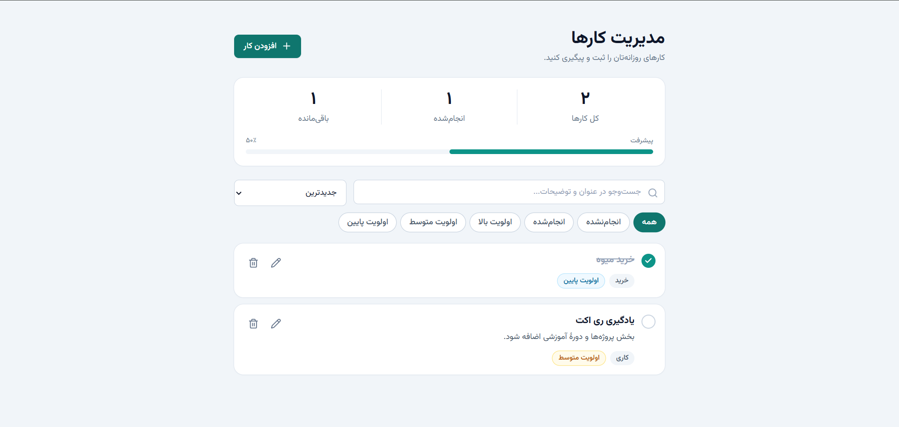
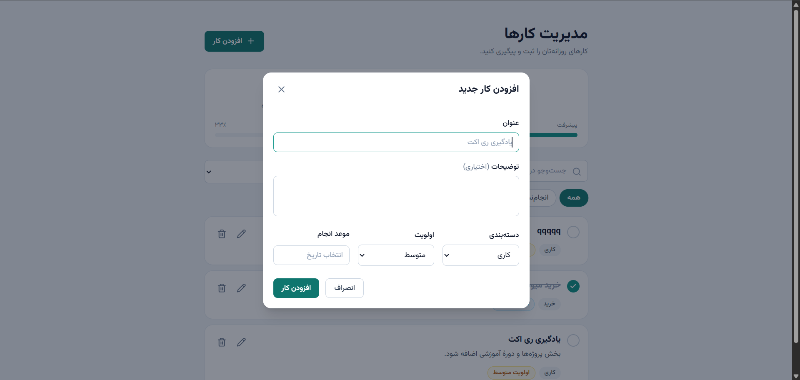
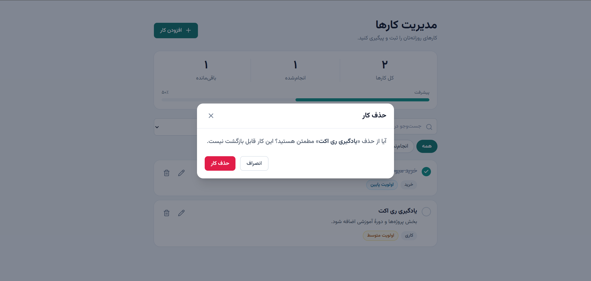
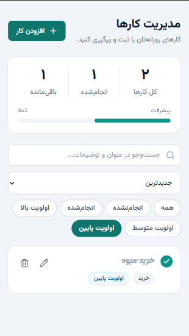

# 📋 Task Manager

A modern, responsive task management application built with **React**, **Tailwind CSS**, and **Vite**. It helps users organize their daily tasks, track progress, and manage deadlines with an intuitive user interface.

## ✨ Features

- **Task Management:** Create, edit, and delete tasks through an intuitive interface.
- **Form Validation:** Validate task titles (3–80 characters) and descriptions.
- **Deletion Confirmation:** Prevent accidental deletions with a confirmation dialog.
- **Categories & Priorities:** Organize tasks by category (Work, Personal, Learning, Shopping) and priority (High, Medium, Low).
- **Due Dates:** Set deadlines and identify overdue tasks.
- **Search & Filtering:** Search tasks by keywords, filter by completion status or priority, and sort tasks by date or priority.
- **Task Statistics:** Track total, completed, and pending tasks with progress indicators.
- **Data Persistence:** Save tasks in browser `localStorage` so they remain available after refreshing the page.
- **Responsive Design:** Enjoy a consistent experience across desktop, tablet, and mobile devices.

## 🛠️ Tech Stack

- **React** – UI development and state management with React Hooks.
- **Tailwind CSS** – Utility-first styling and responsive layouts.
- **Vite** – Development server and build tool.
- **Lucide React** – Icon library.
- **localStorage API** – Client-side data persistence.

## 🚀 Getting Started

Follow these steps to run the project locally.

### 1. Clone the repository

```bash
git clone https://github.com/fatemehJafaei/react-todo-app.git
cd react-todo-app
```

### 2. Install dependencies

```bash
npm install
```

### 3. Start the development server

```bash
npm run dev
```

Open the local URL displayed in your terminal (usually `http://localhost:5173/`).

## 📦 Production Build

Build the application for production:

```bash
npm run build
```

Preview the production build locally:

```bash
npm run preview
```

## 📸 Screenshots

### Main Dashboard



### Add or Edit a Task



### Delete a Task



### Mobile View



## 📄 License

This project is licensed under the MIT License.
